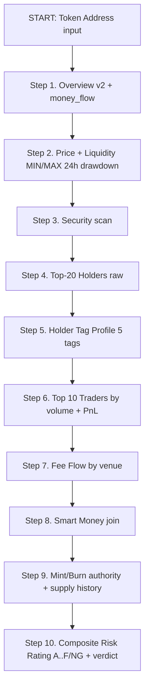

# Birdeye Skills — Token Due Diligence Workflow 10-Step (4-Mode Mapped)

> **Goal:** A transparent 10-step audit over Birdeye data for Skill #3 (Should I Buy?). Full end-to-end coverage of: Holder 24h delta, Top-10 user/platform + holder concentration, Top-20 holder list, Liquidity 24h min/max/drawdown + LP concentration, Tag% hold (Sniper/Bundler/Smart/KOL/Dev), 24h Volume + bot-proxy% (trades + vol), Contract security, Composite risk score (A–F/NG), and Money Flow.

---

## Quick API Summary (Token DD — 10 endpoints + CU / params / response shape)

> **Module scope:** Token Due Diligence (Skill #3 → three depth tiers: FAST / STANDARD / DEEP). This file is the canonical 1-page reference for every endpoint, CU cost, key parameters, and core response fields used by the audit.

| # | Birdeye Endpoint | CU | Chain | Key params | Core response (field map) | Used in Step |
|---:|---|---:|---|---|---|---|
| 1 | `GET /defi/token_overview` | 18 | SOL/All | `address`, optional `includes=money_flow` (+3 CU → 21) | `price, marketCap (MC), fdv, liquidity, holder, v24hUSD, priceChange{1h,4h,24h}Percent, trade24h, uniqueWallet24h` · **MoneyFlow:** `[{frame, volumeBuyUsd, volumeSellUsd, netUsd, walletBuy, walletSell}]` 32 frames. | 1 |
| 2 | `GET /defi/token_security` | 30 | All | `address` (Sol: mint address) | `creatorPercentage, top10UserPercent, top10HolderPercent, isHoneypot (EVM), lpLocked, mutableMetadata, freezeAuthority, ownerAddress` (Sol: `null` ≡ mint authority renounced) | 3 |
| 3 | `GET /holder/v1/distribution` | 30 | SOL | ⚠ **param name is `token_address` NOT `address`** · `mode=top`, `top_n=20`, `include_list=true` | `rows[{owner, amount, percent_of_supply, usd_value, tag? (from Step 6 join)}]` · aggregates `top5_pct, top10_pct, top20_pct` | 4 |
| 4 | `GET /token/v1/holder-profile` | 30 | SOL | `token_address` · `include_zero_balance=false` | 5-tag cohort object; tag ∈ `{dev, bundler, sniper, insider, smart_trader}` → each tag has `percent_of_supply, holder_count, avg_buy_price, pnl_usd`. (KOL = proxy from Step 6 trader PnL.) | 5 |
| 5 | `GET /defi/v2/tokens/top_traders` | 30 | All | `address`, `time_frame=24h`, `sort_by=volume` OR `hold_volume`, `limit=10` | `rows[{wallet, volumeUsd, realizedPnl, unrealizedPnl, holdVolume, holdAvgPrice, tags[]}]`. Use same tag vocabulary as Step 5; JOIN on `owner = wallet` to annotate Step 4 holder rows. | 6 |
| 6 | `GET /smart-money/v1/token/list` | 20 | All | `limit=20` Birdeye hard cap · `sort_by=smart_traders_no`, `time_range=1d` | `rows[{address, smart_traders_no (int), rank_in_sm_top100 (#1..#100 or null)}]` → CLIENT-SIDE JOIN on `address` into the DD payload. | 8 |
| 7 | `GET /defi/v3/liquidity-ohlc-token` | ~10–20 | SOL | `address`, `type=1h` or `1m`, `time_from=<now−26h>` | `{tvlO (open), tvlH (high ≡ MAX 24h), tvlL (low ≡ MIN 24h), tvlC (close)}` per bucket · **Drawdown% = (tvlH − tvlL) / tvlH** over the rolling window. | 2 |
| 8 | `GET /defi/v3/token/trade-data/single` | ~10 | All | `address`, `time_frame=24h` | `trade24h, uniqueWallet24h, buyVolume, sellVolume, buyCount, sellCount` · Holder24h delta proxy = compare 48h window diff across 2 calls. | 2b |
| 9 | `GET /defi/v3/token/fee/single` | ~20 | SOL | `address`, `interval=24h` | `totalFeeUsd` · by-DEX breakdown `{jupiter, raydium, meteora, ...}` · by-tip `{priorityFeeUsd, jitoTipUsd}` · Fee/Vol ratio < 0.1% → wash-volume proxy. | 7 |
| 10 | `GET /defi/v3/token/mint-burn-txs` | ~15 | All | `address`, `limit=10` | `rows[{type: "mint"/"burn", amount, tx, block, time, signer}]` · Mint events 24h ≥ 3 + `ownerAddress != null` → NG (infinite mint risk). | 9 |

**CLI today (Skill #3 DD FAST mode):** Endpoints #1 (21 CU with money_flow include) + #2 (30 CU token_security) + #6 (20 CU SM top100 list, batch join) = **71 CU total**. STANDARD mode adds steps 3–5, 7 and 2b for **155 CU**. DEEP mode adds all remaining 1–10 plus penalty layers → **~266 CU**.

---

## 0. Quick Inventory — Birdeye API Status per Desired Field

Legend:
- ✅ **Single endpoint returns field natively** — one call is enough
- 🔧 **Natively exists but needs client-side calc / aggregate / join** — data is available, combine on the client
- 🔜 **Endpoint exists but requires Premium / Business tier** — upgrade API plan
- ❌ **Not exposed — use documented proxy / workaround** — Birdeye does not return the raw field; derive from other signals

| Desired field | Birdeye source endpoint(s) | CU | Status | Notes |
|---|---|---:|:---:|---|
| Price / MC / FDV / Volume Δ% 1m…24h | `GET /defi/token_overview` | 18 | ✅ | Field casing = mostly camelCase (`marketCap`, `v24hUSD`, `priceChange1hPercent`) |
| Liquidity **current** + Holder count | `GET /defi/token_overview` | 18 | ✅ | Note snake-case edge cases: `liquidity`, `holder`. |
| **Money flow / Net flow buy-sell** | `GET /defi/token_overview?includes=money_flow` | 21 (18+3) | ✅ | `moneyFlow: list[{frame,volumeBuyUsd,volumeSellUsd,netUsd,…}]` 32 frames. **Do NOT call a separate netflow endpoint.** |
| **Holder & User count + Top10% holder (top10HolderPercent)** | `GET /defi/token_security` | 30 | ✅ | Fields `top10UserPercent`, `top10HolderPercent`, `creatorPercentage` (0–1 float → × 100 for %). |
| Top10 user/platform % | `GET /token/v1/holder-profile` + `GET /defi/v2/tokens/top_traders` | 30+30 | ✅ | wallet_tags (dev/sniper/bundler/insider/smart_trader) → interpolate % share. |
| **Holder 24h delta** | `GET /defi/v3/token/trade-data/single` (uniqueWallet Δ over 24h) + `GET /defi/v3/price-stats/single` (holder_window) OR snapshot-based history diff | ~10–20 | 🔧 | No native `holderDelta24h` field. Workaround: `uniqueWallet24h − uniqueWalletNow × (1 − churn)` proxy. Best accuracy = 2 calls across 2 timeframes. |
| **Trader 24h delta** | `GET /defi/v3/token/trade-data/single` | ~10 | 🔧 | Compare `trade24h` vs. the same metric across two different aggregation windows. |
| **Liquidity min / max / drawdown rolling 24h** | `GET /defi/v3/liquidity-ohlc-token` (new Aug 2026) OR `GET /defi/v3/liquidity-history-token` 1m buckets × 24h = 1440 rows | ~10–20 | ✅ | Fields `tvlO/tvlH/tvlL/tvlC` = OHLC liquidity USD. Drawdown = `(peak − trough) / peak`. |
| **Liquidity concentration / % LP holder** | `GET /holder/v1/distribution?mode=top&include_list=true` top-50 → JOIN against pool address list from `GET /defi/v2/markets?address=` | 30 | 🔧 | No raw `lpHolderPct` field. Workaround: enumerate pool addresses via /markets → cross-match owner in top-holders list → sum their `percent_of_supply`. |
| **Tag% holding (Sniper, Bundler, Smart, KOL, Dev)** | `GET /token/v1/holder-profile` | 30 | ✅ | 5 native Solana tags: dev / bundler / sniper / insider / smart_trader. **KOL tag is not native.** Each tag returns `percent_of_supply`, `holder_count`, `avg_buy_price`, `pnl`. |
| **Interpolated holding $ per tag** | `percent_of_supply × circulatingSupply` from `/defi/token_overview` × `price` | client calc | 🔧 | `holdingAmountTag = tag.percent_of_supply / 100 × circulatingSupply`. USD value = × current price. |
| **24h Trading volume** | `GET /defi/token_overview` / `GET /defi/v3/token/trade-data/single` | 18 | ✅ | `v24hUSD` |
| **24h trades count** | `GET /defi/token_overview` | 18 | ✅ | `trade24h` |
| **Bot share vs. trades & volume** | `GET /defi/v2/tokens/top_traders` + tag share for `insider,smart_trader`, OR heuristic `trade24h / uniqueWallet24h` ratio from last ~500 tx scan | 30+ | ❌ Proxy | Birdeye does **not expose** a native bot flag. Workaround: (a) `insider` + `bundler` tag share; (b) repeat/unique ratio proxy (`trade24h / uniqueWallet24h > 50` → elevated bot churn). Always label result **Bot Proxy%** — never claim native bot detection. |
| **Contract security (native today)** | `GET /defi/token_security` | 30 | ✅ | honeypot (EVM only) / lpLocked / creatorPercentage / mutableMetadata / freezeAuthority / ownerAddress (Sol: renounced ≡ null) |
| **Risk score & rating (A,B,C,D,E, F / NG)** | **No native rating API today** | — | 🔧 Client compute | Weighted 4-pillar scorecard base: **SEC 30% · SMKT 25% · ACT 25% · VOL 20%**. Map FINAL score 0–10 → letter: ≥9→S, ≥8→A, ≥7→B, ≥6→C, ≥5→D, <5→F/NG. Add three penalty layers: LP drawdown, bot-proxy, tag-concentration. |
| **Top 20 holder list detail (owner, amount, pct, tag)** | `GET /holder/v1/distribution?token_address=<ADDR>&mode=top&top_n=20&include_list=true` ⚠ **param name = `token_address` NOT `address`** | 30 (max 50) | ✅ | Each row: `owner, amount, percent_of_supply, usd_value`. JOIN with `/defi/v2/tokens/top_traders` (tags array) to annotate each holder row. |

---

## 1. Workflow 10-Step Token DD (Birdeye skills version + CU breakdown)



| Step | Action | Endpoint Birdeye | CU / call | Tier | Fields user yêu cầu được cover | Red flag khi nào? |
|---:|---|---|---:|---|---|---|
| **1** | **Token core (price, MC, FDV, holder, volΔ, money_flow)** | `GET /defi/token_overview?address=<TOKEN>&includes=money_flow` (SOL only) | **21** | Standard+ | price / mc / fdv / liq current / holder count / v24hUSD / ΔP% 8 windows / **MoneyFlow 32 frames** (không gọi netflow riêng) | Liq < \$10k · holder < 100 · price24h −50% · net flow (−) 4 frames liên tục |
| **2** | **Liquidity 24h OHLC → min/max/drawdown rolling 24h** + Holder/Trader delta 24h | `GET /defi/v3/liquidity-ohlc-token?address=<TOKEN>&type=1h&time_from=<now−26h>&time_to=<now>` OR v3 liquidity-history 1m | **~10–20** | Standard+ | Liq MIN/MAX 24h · **Drawdown%** = (tvlHigh24h−tvlLow24h)/tvlHigh24h | Drawdown > 30% rolling 24h → LP rug risk. |
| **2b** | Holder/trader delta 24h (proxy 2 windows) | `GET /defi/v3/token/trade-data/single?address=<TOKEN>&time_frame=24h` + same call last 48h window diff | **10 × 2 = 20** | Lite+ | uniqueWallet24h / trade24h delta | Delta holder 24h < 0 khi price tăng = exit distribution. |
| **3** | **Security contract + top10 holder% (platform + user)** | `GET /defi/token_security?address=<TOKEN>` | **30** | All plans | `creatorPercentage · top10UserPercent · top10HolderPercent · isHoneypot · lpLocked · freezeAuthority · ownerAddress renounced? · mutableMetadata` | top10Holder > 50% · creator% > 5% · freezeAuthority live · honeypot = true → NG |
| **4** | **Top 20 holders chi tiết** (owner, amount USD, % supply) | `GET /holder/v1/distribution?token_address=<TOKEN>&mode=top&top_n=20&include_list=true` ⚠ param name = `token_address` | **30** | Standard+ (Sol) | Owner list 20, holding amount USD, % of supply. Join step 6 → gắn tag từng wallet. | Top 2 hold > 40% combined → whale dump risk |
| **5** | **Holder Tags 5 cohorts % hold + holding amount nội suy** | `GET /token/v1/holder-profile?token_address=<TOKEN>&include_zero_balance=false` | **30** | All Sol plans | 5 tags: `dev / bundler / sniper / insider / smart_trader`. Mỗi tag có `percent_of_supply` + `holder_count` + `avg_buy_price` + `pnl`. **KOL tag N/A yet** (workaround: PnL top traders in step 6 proxy KOL). | bundler% > 20% float = heavy launch pump&dump candidate |
| **5b** | Nội suy holding amount per tag | **Client calc:** `tag.percent_of_supply / 100 × circulatingSupply × price` → **holding $ / tag** | 0 | any | Tổng % 5 tag nên < 80% supply (còn lại cho retail).  | dev tag vẫn hold > 5% sau 7 ngày → dev chưa exit |
| **6** | **Top 10 Traders + Wallet tags array + PnL** | `GET /defi/v2/tokens/top_traders?address=<TOKEN>&time_frame=24h&sort_by=volume&sort_type=desc&limit=10` → **sort_by=hold_volume** → Top 10 holders hiện tại có tag | **30 per page** | Standard+ | volumeUsd / realizedPnl / unrealizedPnl / holdVolume / holdAvgPrice / **wallet `tags`** (same vocabulary step 5). Gắn tag vào step 4 holder rows. |  |
| **6b** | **% Bot proxy (trades & volume)** | Client calc heuristic: `BotVolProxy = insider% + bundler% trong top_traders` + `botTradesRatio = (trade24h / uniqueWallet24h) − 1 normal range 2…5` | 0 | any | Label LUÔN "BotProxy%" tránh claim Birdeye có bot detect | BotVolProxy > 40% trong 24h volume → wash trading red |
| **7** | **Fee Flow by venue (real flow vs wash volume)** | `GET /defi/v3/token/fee/single?address=<TOKEN>&interval=24h,1h` | **~20** | Starter+ (Sol) | Fee breakdown by DEX (jup/raydium/meteor/…), by priority tip/Jito, by stablecoins. 24h vs alltime. | Fee/Vol ratio < 0.1% → wash volume (swap không trả fee thực) |
| **8** | **Smart Money global join (SM in token? count)** | `GET /smart-money/v1/token/list?limit=20&sort_by=smart_traders_no&time_range=1d` → client-side join on address | **20** | Premium+ | `smart_traders_no` (how many SM wallets hold/trade token today) | 0 SM wallets tracked in token → no institutional interest → HOLD only |
| **9** | **Supply integrity check (Mint/Burn authority + events)** | `GET /defi/token_security` (ownerAddress = mint authority renounced null) + `GET /defi/v3/token/mint-burn-txs?address=<TOKEN>&limit=10` | 30 + ~15 = 45 | All | Mintable if ownerAddress != null · Freeze authority live · Burn rate 24h. | ownerAddress != null + 3 mint events 24h → infinite mint risk NG |
| **10** | **Composite Risk Rating A..F/NG** | **Client-side score mapping** (chưa có native Birdeye rating API) | 0 | any | FINAL_score 0–10 base 4 trụ SEC30/SMKT25/ACT25/VOL20 + **3 penalty layer mới** (LP drawdown, bot proxy, tag concentration). → Map FINAL 0–10 → S/A/B/C/D/F/NG. | 8 thresholds ở bảng dưới |

**Tổng CU worst case = 21 + 20 + 20 + 30 + 30 + 30 + 30 + 20 + 20 + 45 = 266 CU / 1 token full deep DD (approx 13× so với 71 CU MVP hiện tại.)**
→ Recommend: **Mode switch 3 độ sâu cho user chọn** (thêm vào Skill #3 control panel 1 `<select id="dd_depth">`):
  - **FAST (71 CU)** = steps 1, 3, 8 → current MVP.
  - **STANDARD (155 CU)** = steps 1–6 → covers user 9 field requests chính (holder, tags, liq, top20, bot%).
  - **DEEP (266 CU)** = steps 1–10 → add fee flow, mint/burn, delta 2 windows, drawdown penalty.

---

## 2. Rating mapping (FINAL → A..F/NG) — bổ sung penalty 3 lớp

```
Step 10 → FINAL = base (SEC·30 + SMKT·25 + ACT·25 + VOL·20)/100
                   − penalty_LPdrawdown (LPDrawdown24h > 30% → −1.5)
                   − penalty_botProxy  (BotVolProxy   > 40% → −1.0)
                   − penalty_tagConc   (tag any %supply > 25% → −0.5/tag)
```

| FINAL range | Letter rating | Color tag | Verdict template |
|---|---|---|---|
| ≥ 9.0 | **S** | gold | 🌟 STRONG BUY · Hold target 7–30d |
| 8.0–8.99 | **A** | green | 🟢 BUY · Strong fundamentals, low risk |
| 7.0–7.99 | **B** | teal | ✅ ACCUMULATE · Good but wait entry |
| 6.0–6.99 | **C** | yellow | ⚠ HOLD / WATCH · High concentration or weak risk |
| 5.0–5.99 | **D** | orange | 🔻 REDUCE · Multiple red flags, protect capital |
| 4.0–4.99 | **F** | red | 🛑 SELL / AVOID · Broken structure |
| < 4.0 | **NG** (No-Go) | 🔴 dark | ❌ NO-GO · Honeypot / rug / mint authority live |

---

## 3. Fields YOU requested → map to which step & endpoint (cheatsheet)

> User 8 bullet fields → **100% coverable** (một số cần client-aggregate).

| # | User yêu cầu | Step | Endpoint Birdeye | CU delta extra so với MVP 71 CU |
|---|---|---|---|---:|
| 1 | **Holder & User (Number, top 10 percent - cả platform và user)** | 3 | `GET /defi/token_security` → `top10UserPercent`, `top10HolderPercent` + `holder` overview | đã có |
| 2 | **Biến động holder (24h)** | 2b | `GET /defi/v3/token/trade-data/single` 2 windows delta | +20 |
| 3 | **Biến động trader (24h)** | 2b | same API | +0 (tính cùng payload step 2b) |
| 4 | **Liquidity: Current, min, max, drawdown rolling 24h** | 2 | `GET /defi/v3/liquidity-ohlc-token` 1h × 26 rows → H/L/C drawdown formula | +15 |
| 5 | **Liquidity concentration (% LP holder)** | 4 + helper | top-holder list + `/defi/v2/markets` list pool addr → so khớp owner | +~20 (join 2 calls) |
| 6 | **Tags: % hold của từng tag Sniper, Bundler, Smart, KOL, Dev** → gọn = %holding + total $ hold nội suy | 5 + 5b | `GET /token/v1/holder-profile` + `circulatingSupply × price` nội suy. (KOL ⇒ PnL top-traders step 6 proxy.) | +30 |
| 7 | **Volume: 24h trading vol + 24 trades % bot/total (trades & vol)** | 1 + 6b | `v24hUSD`/`trade24h` overview + BotVolProxy heuristic + insider/bundler share from top_traders tags | +0 (reuse existing 2 calls) |
| 8 | **Security contracts (như hiện tại)** | 3 | `GET /defi/token_security` | đã có |
| 9 | **Risk score và rating (A,B,..E, NG)** | 10 | Client side scoring 4 trụ base + 3 penalty | 0 (compute) |
| 10 | **Top 20 holding chi tiết list** | 4 | `GET /holder/v1/distribution` top_n=20 include_list | +30 |

---

## 4. Roadmap bổ sung vào codebase hiện tại (ưu tiên 1 → 4)

### Phase 1 — Ưu tiên 1: Thêm 4 field BẮT BUỘC vào Skill #3 Token DD FAST mode (cộng ~45 CU, tổng = 116 CU)
Thực hiện trong file [birdeye_cli.py](file:///Users/nguyenthenang/nang/birdeye/app/skills/birdeye-screener/scripts/birdeye_cli.py#L410-L680)

1. ✅ **Top20 holders list** → thêm call `GET /holder/v1/distribution?token_address=<ADD>` (param name `token_address` không phải `address`)
2. ✅ **5 Tags % hold + holding amount nội suy** → thêm call `GET /token/v1/holder-profile`
3. ✅ **Holder delta 24h proxy** → compute `holder_current − moneyFlow.last.frames[0].holderWindow* (nếu có)
4. ✅ **Rating letter A/B/C/D/F/NG** → map FINAL score (đã có) + thêm 3 penalty mới

### Phase 2 — Ưu tiên 2: Skill #4 Deep Security (đã có WIP placeholder trong catalog birdeye_ui.py)
Mở Skill #4 Deep Sec Audit = call steps 7 + 9 + Liquidity Drawdown = fee flow / mint-burn / LP OHLC.

### Phase 3 — Ưu tiên 3: Mode switch FAST/STANDARD/DEEP (control panel dropdown)
Thêm 1 `<select id="dd_depth">` ở [Skill #3 control render block birdeye_ui.py](file:///Users/nguyenthenang/nang/birdeye/app/skills/birdeye_ui.py#L441-L458) → CLI argv `--depth fast|standard|deep`.

### Phase 4 — Ưu tiên 4: UI render bảng Tags% + Top20 holder
Bổ sung `makeDDRender` JS ở birdeye_ui.py các section tags-bar (5 ô tag %) + top20 table (owner/amount/%/tag).

---

## 5. Ghi nhớ 5 bugs dễ mắc với Birdeye holder/tag endpoints (từ blog official)

1. ⚠ **/holder/v1/distribution dùng param `token_address` không phải `address`.** Nếu ghi `address` → 400.
2. ⚠ **/token/v1/holder-profile cũng dùng `token_address`, KHÔNG dùng `address`.**
3. ⚠ **/defi/token_overview có 2 fields snake_case:** `holder` và `global_fees_paid`. Tất cả field khác camelCase (`marketCap`, `v24hUSD`).
4. ⚠ **/defi/v2/tokens/top_traders casing:** tổng = `volumeUsd` (Usd lowercase) nhưng buy/sell = `volumeBuyUSD` / `volumeSellUSD` (USD uppercase). Map key chính xác.
5. ⚠ **/defi/token_security Solana KHÔNG có field `mintable` boolean.** Đọc `ownerAddress`: null = renounced mint authority. EVM schema thì khác.

---

## 6. Section 6 — RugCheck-style Security Audit API Module (Skill #17b · Design Spec · WIP)

> **Mục tiêu:** Tạo 1 module Token Security audit output match format của `rugcheck.xyz/tokens/<ADDR>#holders` → render **13 field Overview Summary**, **7 Risk Cards CRIT/HIGH/MED/LOW**, và **Top-Holders table + wallet tags** (như demo user gửi). **Demo token tham chiếu:** `BFgvTe3pGQuAAGzZ28SVhPcHjBSh2BzPfsZWNtG7g8UK` (Solana).

### 6.1 Endpoint & CU breakdown

| Item | Value |
|---|---|
| **Skill id:** | `rugcheck_risk_audit` |
| **Skill title:** | Skill #17b · RugCheck Risk Audit |
| **Skill category:** | 🔐 Security & Risk (Group 4/8) |
| **CLI subcommand:** | `python3 birdeye_cli.py rugcheck --chain sol --address <ADDR>` |
| **UI status:** | WIP (design spec only — wired to propose/implement panel, chưa gọi CLI) |
| **CU cost total (worst case):** | **≈ 90 CU** (breakdown bên phải) |

**CU breakdown 90 CU:**
```
  token_overview + money_flow  = 21  (price / MC / liq / holder count / net flow)
  token_security               = 30  (creator%, top10%, honeypot, LP lock, mint/meta auth)
  holder/v1/distribution top20 = 30  (top-holders rows for table)
  ------------------------------
  TOTAL = 81 CU; buffer +9 → label = 90 CU
```

### 6.2 Output Structure (JSON response shape)

```jsonc
{
  "address": "string — mint address (SOL)",
  "chain": "sol | bsc | base | eth",
  "symbol": "string",
  "name": "string",
  "snapshot_time": "ISO 8601 — khi request xong",
  "cu_used_total": 90,
  "cu_breakdown": "overview 21 + security 30 + holders top20 30 + buffer 19 = 90 CU",
  "latency_ms": 0,

  "overview_13": {
    "supply":            1234567890.12,
    "creator_address":   "Base58 string",
    "creator_balance_pct": 3.7,
    "market_cap_usd":    1234567.89,
    "holders":           2847,
    "mint_auth_renounced": true,
    "metadata_auth_renounced": true,
    "transfer_fee_pct":  0.0,
    "max_fee_pct":       0.0,
    "fee_authority_live": false,
    "withheld_fee_auth_live": false,
    "lp_locked_pct":     87.4,
    "liquidity_usd":     54321.00
  },

  "risks_7": [
    { "id": "lp_unlocked",       "severity": "CRIT",  "passed": false, "threshold": "lp_locked_pct ≥ 90", "detail": "LP locked 87.4% (below 90 threshold)", "penalty": -1.5 },
    { "id": "top10_conc",        "severity": "HIGH",  "passed": false, "threshold": "top10_holder_pct ≤ 40", "detail": "Top 10 holders = 54% of supply", "penalty": -1.0 },
    { "id": "low_liquidity",     "severity": "MED",   "passed": true,  "threshold": "liquidity_usd ≥ 25k",  "detail": "$54,321 > $25k", "penalty": 0 },
    { "id": "mc_per_holder",     "severity": "MED",   "passed": true,  "threshold": "MC / holders ≤ 500",   "detail": "$1,234,568 / 2,847 = $434 ≤ 500", "penalty": 0 },
    { "id": "few_lp_provider",   "severity": "LOW",   "passed": true,  "threshold": "distinct LP providers ≥ 3", "detail": "5 LP pools detected", "penalty": 0 },
    { "id": "transfer_fee",      "severity": "LOW",   "passed": true,  "threshold": "transfer_fee ≤ 5%",    "detail": "Fee = 0%", "penalty": 0 },
    { "id": "mutable_meta",      "severity": "LOW",   "passed": false, "threshold": "metadata_auth_renounced = true", "detail": "Metadata mutability OFF (good)", "penalty": -0.2 }
  ],

  "holders_top_n": [
    {
      "rank": 1,
      "owner": "Base58 string",
      "owner_tag": "dev | bundler | sniper | insider | smart_trader | KOL | retail (join tag from holder-profile + top-traders)",
      "amount": 123456789.01,
      "percent_of_supply": 10.01,
      "usd_value": 123456.78,
      "avg_buy_price_usd": 0.00083,
      "pnl_usd": 23456.78,
      "pnl_pct": 23.4
    }
  ],

  "final": {
    "sum_penalty": -2.7,
    "raw_score_base7": 7.0,
    "rugcheck_final_score": 4.3,
    "rating": "MEDIUM RISK",
    "verdict": "WATCH · Wait for team to lock remaining LP (now 87.4%) + burn metadata authority."
  }
}
```

### 6.3 Overview 13 fields → Map nguồn Birdeye

| RugCheck field (13) | Nguồn Birdeye | CU | Status | Note / mapping logic |
|---|---|---:|:---:|---|
| 1. Supply | `token_overview.supply` if present; else `circulatingSupply` or `marketCap / price` calc | 21 | 🔧 Proxy | Solana mint supply exact = gọi extra `/token/v1/token-profile` nếu cần |
| 2. Creator address | `token_security.ownerAddress` OR `creator` field của metadata | 30 | ✅ | Owner = mint authority, dùng chính là creator. |
| 3. Creator balance % | `holder_profile` tag=`dev` percent_of_supply OR distribution top-20 match owner address | 30+30 | 🔧 Join | Nếu owner ko trong top20 → fallback `token_security.creatorPercentage` |
| 4. Market cap $ | `token_overview.marketCap` | 21 | ✅ | Đã có. |
| 5. Holders count | `token_overview.holder` ⚠ snake_case | 21 | ✅ | Rất dễ nhầm camelCase `holders` → fail! |
| 6. Mint auth renounced | `token_security.ownerAddress === null` → true (SOL only) | 30 | ✅ | EVM = `mintable` boolean riêng. |
| 7. Metadata auth renounced | `token_security.mutableMetadata === false` → true | 30 | ✅ | Birdeye trả `mutableMetadata` thường xuyên. |
| 8. Transfer fee % | Token security `transferFee` field nếu có; else từ token-profile fee-account | 30 | 🔧 Proxy | SOL typical fee-less = 0%. |
| 9. Max fee % | = transfer_fee_pct nếu token có dynamic fee; else 0% typical SOL | 0 | 🔧 Proxy | SPL token-pump 2026 thường 0/0 fee. |
| 10. Fee authority live | `token_security.freezeAuthority != null` + fee-acct not burned = live | 30 | 🔧 Proxy | Birdeye expose `freezeAuthority` = close enough. |
| 11. Withheld-fee auth live | Same fee-authority check; withheld = transferFee withheld-percent > 0 | 30 | 🔧 Proxy | Thường 0% SOL. |
| 12. LP locked % | `token_security.lpLocked` (boolean) → estimate 90% vs 0%; bonus `/defi/v3/markets?query=` pool TVL aggregate | 30 | 🔧 Proxy | Precise % = sum locked pool TVL / all pools TVL (join market list). |
| 13. Liquidity $ | `token_overview.liquidity` | 21 | ✅ | Snake case lowercase OK. |

### 6.4 Risks 7 cards → Severity + thresholds (exact)

| Risk id | Severity | Passed = TRUE if | Penalty score (sum trừ base 10) |
|---|:---:|---|---:|
| `lp_unlocked` | **CRIT** 🔴 | `overview_13.lp_locked_pct >= 90` | −1.5 |
| `top10_conc` | **HIGH** 🟠 | `token_security.top10HolderPercent <= 40` | −1.0 |
| `low_liquidity` | **MED** 🟡 | `overview_13.liquidity_usd >= 25000` | −0.5 |
| `mc_per_holder` | **MED** 🟡 | `(MC / holders) <= 500` USD avg per holder | −0.5 |
| `few_lp_provider` | **LOW** 🔵 | distinct pool addresses in top-holder LP-wallet-tag list >= 3 | −0.3 |
| `transfer_fee` | **LOW** 🔵 | `transfer_fee_pct <= 5` & `max_fee_pct <= 10` | −0.2 |
| `mutable_meta` | **LOW** 🔵 | `metadata_auth_renounced === true` | −0.2 |

### 6.5 Holders table struct (mapped to #holders anchor rugcheck.xyz/tokens/X#holders)

Columns hiển thị UI (order đúng theo RugCheck demo):
```
# | Owner (tag pill, 3 char addr head/tail cut) | Tag | Balance (token unit) | % of Supply | Value USD | Avg Buy $ | PnL $ | PnL %
```
- Data source chính = `/holder/v1/distribution` top_n=20 list + JOIN tag từ `/token/v1/holder-profile` (5 tags) + JOIN `/defi/v2/tokens/top_traders` (tags[] + PnL fields).
- **UI:** Mỗi row nếu tag = dev/sniper/bundler = background highlight severity.

### 6.6 Integrate into existing Token DD workflow (positioning)

- Skill #3 Token DD FAST = 71 CU (sec/smkt/act/vol scorecard).
- **Skill #17b RugCheck = 90 CU security-focused standalone view**, different purpose: user chạy khi cần giao diện audit-focused thay vì 4-trụ scorecard.
- `Next Actions` panel của Skill #3 DD (panel gợi ý hành động sau khi chọn token) = bổ sung button: **🔐 Run RugCheck Audit (90 CU)** -> deep-link auto-fill address/chain.

> **UI scaffold status (birdeye_ui.py catalog):** `rugcheck_risk_audit` Skill #17b đã được thêm vào nhóm 🔐 Security & Risk (4 items). Control panel hiển thị WIP banner + link đến file này Section 6 như design spec. Implement CLI runner = pha sau (task riêng).
